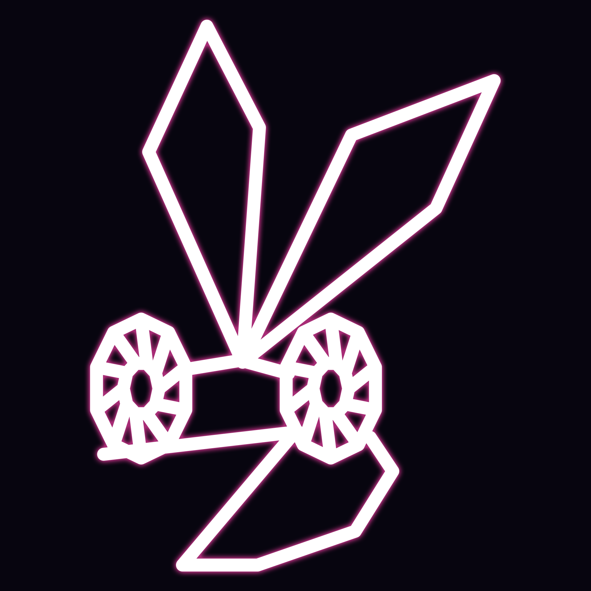

<p align="center"></p>

<h1 align="center">Vib-Ribbon Player</h1>

Play **Vib-Ribbon** (PlayStation, 1999) with any song you like. Point the player at your own copy of the game
and at a song (mp3, m4a, flac, ogg, wav...), press **Play**, and the game starts with that song: the player
takes the game to its "play with my own choice of CD" menu for you and hands it your song as if it were the
music CD.

* The game is **not modified** in any way. Everything the player does for you (menus, swapping the "CD") is
  done with controller presses and a virtual disc swap, scripted as small *macros*.
* No BIOS, no other files needed: the PlayStation's system software is re-implemented.
* **This repository contains no game data.** You need your own copy of Vib-Ribbon.

## Download

Builds for **Windows**, **macOS** (Apple silicon and Intel) and **Linux** are on the
[Releases](../../releases) page (`nightly` is the latest unfinished build). Unpack the archive and start the
program.

* *Windows:* if SmartScreen warns about an unknown publisher, choose "More info" > "Run anyway".
* *macOS:* the app is not notarised. The first time, right-click `Vib-Ribbon Player.app` and choose "Open".
* *Linux:* run `vibribbon-player`; the archive also holds a `.desktop` file and the icon if you want a menu entry.

## Using it

1. Get your disc image: a `.cue` file with its `.bin` files next to it, or a single `.chd` (make one with
   `chdman createcd -i game.cue -o game.chd`). Currently supported: the European release (SCES-02873).
2. Start the player, press **Choose disc image...**, then **Choose song...** (or just drag the files onto the
   window).
3. Press **Play with my song**. After a few seconds of automatic setup the game starts with your song.
4. **How to play** runs the game's own tutorial.

Press `Esc` while playing for the pause menu, `F11` (or double click) for full screen.

### Controls

Vib-Ribbon uses only four buttons: **Down**, **L1**, **R1** and **Cross (X)**, one for each kind of obstacle
(pit, block, loop, wave). Two obstacles at once need two buttons at once.

| Button | Default key | | Button | Default key |
|---|---|---|---|---|
| Down | `↓` | | Start | `Enter` |
| L1 | `Q` | | Select | `Backspace` |
| R1 | `W` | | Up / Left / Right | arrow keys |
| Cross (X) | `Z` | | Circle / Square / Triangle | `X` / `A` / `S` |

Keys can be changed in **Settings & controls**. Gamepads work in builds made with the `gamepad` feature (the
release builds are).

## Building from source

You need a recent stable [Rust](https://rustup.rs) and a C compiler (gcc or clang; on Windows use MinGW-w64).

```sh
cargo build --release -p vibribbon-player           # target/release/vibribbon-player
cargo build --release -p vibribbon-player --features gamepad   # with gamepad support (needs libudev headers on Linux)
cargo test --workspace
```

Nothing else has to be installed: audio libraries are loaded at run time.

## How it works

* `runtime/` - the PlayStation machine in C: MIPS R3000A interpreter, GTE, GPU, SPU (with the CD-audio
  capture path Vib-Ribbon relies on), CD-ROM controller, DMA, timers, controller port, and a high-level
  re-implementation of the BIOS kernel. `vibrt.h` is its public API.
* `crates/vibrt` - Rust bindings. `crates/media` - disc images (CUE/BIN, CHD) and song decoding (Symphonia).
  `crates/macros` - the macro engine and the per-disc profiles (`crates/macros/profiles/*.toml`).
  `crates/audioout` - audio output (miniaudio). `player/` - the application (egui).
* Vib-Ribbon builds its levels by analysing the music of the CD it is given. The player supplies the song as a
  virtual one-track CD, swapped in at the moment the game asks for a music CD.

More for developers (headless mode, regression testing, the recompiler experiments) in
[docs/DEVELOPING.md](docs/DEVELOPING.md).

## Legal

Vib-Ribbon is a trademark and copyright of Sony Interactive Entertainment / NanaOn-Sha. This is an
independent project and is not affiliated with them. Use it only with a copy of the game you own.

## Licence

The code in this repository is licensed under either of

* [Apache License, Version 2.0](LICENSE-APACHE)
* [MIT license](LICENSE-MIT)

at your option. This covers the player and the machine core only; it does not cover the game. miniaudio
(bundled in `crates/audioout/c`) is public domain / MIT-0; the Rust dependencies carry their own licences,
listed in `THIRD_PARTY_LICENSES.html` inside the release archives. The logo in `assets/` shows Vibri, a character
from the game, and is not covered by these licences.
